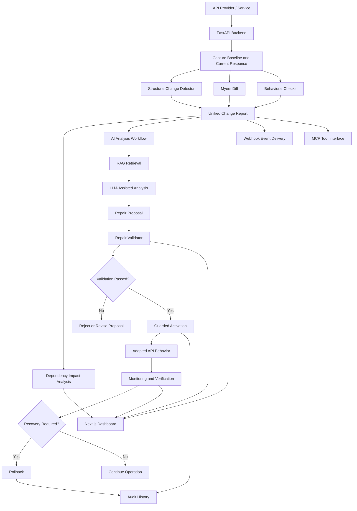

# KintsuTech
 
### Detect. Adapt. Recover.
 
**KintsuTech is an AI-assisted API resilience platform that detects API changes, analyzes their impact, proposes compatibility repairs, validates those repairs, and supports controlled recovery.**
 
Modern applications depend on APIs that keep evolving. A provider may rename a field, change a data type, or alter response behavior, and downstream services can break even though nobody touched them.
 
KintsuTech combines deterministic change detection, dependency analysis, Myers Diff, AI-assisted reasoning, retrieval-augmented generation (RAG), and guarded repair workflows, so developers can understand and respond to API changes with confidence.
 
---
 
## Overview
 
KintsuTech moves teams beyond basic failure monitoring toward understanding, validating, and recovering from API changes. It brings together six capabilities:
 
1. **Change Detection**: identifies structural differences between API responses.
2. **Change Analysis**: combines schema findings, text-level differences, and available behavioral evidence into one report.
3. **Dependency Impact Analysis**: identifies downstream services that may be affected.
4. **AI-Assisted Reasoning**: uses a language model and retrieved examples to explain changes and propose repairs.
5. **Repair Validation**: checks proposed transformations against validation rules and expected outputs.
6. **Controlled Recovery**: supports guarded adapter activation, rollback, and audit history.
The goal: help developers understand **what changed**, **why it matters**, and **what can be done safely**.
 
---
 
## Key Features
 
### 1. API Change Detection
 
Detects structural changes in API responses, including:
 
- Added fields
- Removed fields
- Data type changes
- Nested field changes
- Unchanged responses
Structural analysis helps separate a potentially contract-breaking change from an ordinary change in response data.
 
### 2. Myers Diff
 
KintsuTech includes a Myers Diff implementation for text-level comparison. It finds a shortest sequence of insertions and deletions that transforms one sequence into another, and the result complements structural API analysis.
 
### 3. Dependency Impact Analysis
 
The dependency graph models relationships between services and highlights downstream services that may be affected by a change, so developers can investigate impact instead of viewing a change in isolation.
 
### 4. AI-Assisted Change Analysis
 
The AI workflow combines change evidence with contextual information to produce analysis and potential repair proposals. It can use retrieval-augmented generation (RAG) to pull relevant examples from its knowledge base.
 
### 5. Repair Validation
 
Proposed repairs are checked against supported transformation rules and configured test cases. Validation keeps an unverified AI-generated proposal from being treated as a safe repair.
 
### 6. Controlled Activation and Rollback
 
The platform supports a guarded repair lifecycle:
 
1. Generate a repair proposal.
2. Validate the proposal.
3. Activate an eligible repair.
4. Inspect the resulting behavior.
5. Roll back when necessary.
6. Review the audit history.
### 7. Developer Dashboard
 
The Next.js frontend provides screens for system status, API changes, dependency relationships, recovery workflows, validation results, and AI-assisted analysis.
 
### 8. Model Context Protocol (MCP) Integration
 
KintsuTech includes MCP-related capabilities that expose platform operations through a structured tool interface, enabling compatible AI clients to interact with supported functionality.
 
Potential use cases include:
 
- Inspecting service dependencies and impact.
- Retrieving change and incident information.
- Validating repair proposals.
- Accessing guarded repair operations with appropriate authorization.
> The available tools and operations depend on the configured MCP implementation and its access controls.
 
### 9. Webhook Integration
 
KintsuTech supports webhook subscriptions and event delivery, enabling external systems to receive notifications about supported platform events.
 
Capabilities include:
 
- Webhook subscription management.
- Event delivery and delivery history.
- Request authentication and signature verification.
- Retry handling and idempotency protections.
- Protection against unsafe webhook destinations.
> Webhook configuration and delivery behavior depend on the deployed environment.
 
### 10. SDK and Developer Integration
 
KintsuTech is designed to fit into developer workflows and API-consuming applications.
 
The current platform provides HTTP API endpoints that clients can call directly. A dedicated SDK should be documented as available only once a published and tested SDK package exists.
 
Future SDK development could provide:
 
- Reusable client libraries.
- Typed request and response models.
- Simplified integration with supported programming languages.
---
 
## System Architecture
 
The diagram below shows the major components and their responsibilities.
 

 
### Component Responsibilities
 
| Component | Responsibility |
|---|---|
| Next.js frontend | Presents changes, dependencies, analysis, and recovery workflows |
| FastAPI backend | Exposes REST endpoints and coordinates application workflows |
| Structural detector | Identifies schema-level differences |
| Myers Diff | Calculates text-level edit sequences |
| Dependency graph | Represents service relationships and potential impact |
| AI engine | Produces contextual analysis and repair proposals |
| RAG pipeline | Retrieves relevant examples for analysis |
| Repair validator | Checks supported transformations and expected results |
| MCP interface | Exposes supported operations as tools for compatible AI clients |
| Webhook delivery | Notifies external systems about supported platform events |
| Persistence layer | Stores application state and workflow records |
 
---
 
## Workflow
 
KintsuTech follows a controlled sequence from detection to recovery.
 
| Step | Stage | What happens |
|---|---|---|
| 1 | **Detect** | Capture or provide a baseline response and a current response; the change detector identifies differences. |
| 2 | **Analyze** | Structural findings, text-level differences, and behavioral checks are combined into a unified report. |
| 3 | **Assess Impact** | The dependency graph shows which downstream services may be affected. |
| 4 | **Propose** | The AI workflow uses change evidence and retrieved examples to suggest a compatibility repair. |
| 5 | **Validate** | The proposal is checked against supported operations, expected output, and configured validation requirements. |
| 6 | **Activate Carefully** | Only eligible proposals pass through the activation guardrails. |
| 7 | **Verify and Recover** | Adapted behavior is inspected; if needed, the active adapter is rolled back and the audit history reviewed. |
 
> **Important:** AI-generated proposals are never automatically trusted. Validation and activation are separate stages.
 
---
 
## Technology Stack
 
| Layer | Technologies |
|---|---|
| Frontend | Next.js, React, TypeScript |
| Backend | Python, FastAPI, Uvicorn |
| AI engine | Python, LLM-assisted analysis, RAG |
| Local inference | Ollama-compatible models |
| Embeddings | `nomic-embed-text` |
| Language model | `qwen2.5:3b` |
| Change comparison | Myers Diff |
| Dependency analysis | NetworkX |
| Database | SQLite, SQLAlchemy |
| Testing | pytest |
| Containerization | Docker |
 
The AI model configuration can vary by environment. Model availability and successful inference depend on your local Ollama installation and configuration.
 
---
 
## Project Structure
 
```text
KintsuTech/
├── backend/
│   ├── app/
│   │   ├── main.py
│   │   ├── change_detector.py
│   │   ├── dependency_graph.py
│   │   └── ...
│   ├── data/
│   ├── tests/
│   ├── Dockerfile
│   ├── demo_walkthrough.sh
│   ├── pyproject.toml
│   ├── uv.lock
│   └── README.md
│
├── ai_engine/
│   ├── myers_diff.py
│   ├── change_report.py
│   ├── change_workflow.py
│   ├── repair_agent.py
│   ├── rag_engine.py
│   ├── repair_validator.py
│   ├── repair_pipeline.py
│   ├── incidents.json
│   ├── tests/
│   ├── pyproject.toml
│   └── uv.lock
│
├── frontend/
│   ├── src/
│   │   ├── components/
│   │   └── lib/
│   └── package.json
│
└── dev.sh
```
 
Some directories contain additional modules not shown here.
 
---
 
## Getting Started
 
### Prerequisites
 
- Python 3.12 or a compatible version supported by the project
- [`uv`](https://docs.astral.sh/uv/) for Python dependency management
- Node.js and npm
- Git
- Docker Desktop (optional, to run the backend in a container)
- Ollama and the configured models (optional, for local LLM inference)
### 1. Clone the Repository
 
```bash
git clone https://github.com/YashBarfa0603/KintsuTech.git
cd KintsuTech
```
 
### 2. Start the Backend
 
From the repository root:
 
```bash
cd backend
uv sync
uv run uvicorn app.main:app --reload --port 8000
```
 
Once running, the backend is available at:
 
- API base: `http://127.0.0.1:8000`
- Interactive docs: `http://127.0.0.1:8000/docs`
Keep this terminal open.
 
### 3. Start the Frontend
 
In a second terminal, from the repository root:
 
```bash
cd frontend
npm install
npm run dev
```
 
Open the URL printed by Next.js, usually `http://localhost:3000`.
 
The frontend API client defaults to `http://localhost:8000` unless `NEXT_PUBLIC_API_URL` is set. If your environment uses different ports or URLs, configure them accordingly.
 
### 4. Configure Local AI Inference (Optional)
 
Install and start Ollama, then pull the models used by your configuration:
 
```bash
ollama pull qwen2.5:3b
ollama pull nomic-embed-text
```
 
Verify the installed models:
 
```bash
ollama list
```
 
> A successful backend startup does not guarantee that the local LLM is available. AI analysis may require additional configuration.
 
### Environment Configuration
 
Configure environment variables for the backend and frontend as needed. For production, set appropriate credentials, webhook secrets, frontend origins, and other required settings.
 
> **Never commit `.env` or `.env.local` files that contain secrets.**
 
---
 
## Running the Application
 
### API Documentation
 
Open `http://127.0.0.1:8000/docs`. Swagger UI lets you browse endpoints, inspect request schemas, submit test payloads, and examine responses.
 
### Health Check
 
```http
GET /api/v1/health
```
 
For a more detailed readiness check, look for the readiness route in Swagger UI.
 
### Main API Workflow
 
The backend exposes endpoints for change analysis, AI-assisted analysis, services, dependencies, monitoring, repair validation, activation, and rollback. Exact request schemas are available at `/docs`.
 
---
 
## Testing the API
 
This example submits two API response versions for structural comparison.
 
In Swagger UI, open `POST /api/v1/analyze/changes`, choose **Try it out**, and submit:
 
```json
{
  "baseline": {
    "city": "Indore",
    "temperature": 28,
    "humidity": 60
  },
  "current": {
    "city": "Indore",
    "temp": 28,
    "humidity": 60
  }
}
```
 
### Expected Analysis
 
The baseline contains `temperature`, while the current response contains `temp`. The structural detector should report one removed field and one added field.
 
This illustrates a typical compatibility issue: a downstream consumer expecting `temperature` may not understand `temp`.
 
> The example uses supplied JSON only. It does not modify any real third-party API.
 
### AI-Assisted Analysis
 
Explore these endpoints in Swagger UI:
 
- `POST /api/v1/analyze/changes/ai`
- `POST /api/v1/ai/analyze`
Use the request schema shown by your running backend. AI inference requires the configured workflow and its dependencies to be available.
 
---
 
## Running Tests
 
KintsuTech has separate test suites for the backend and AI engine.
 
```bash
# Backend tests
cd backend
uv run pytest -v
 
# AI engine tests
cd ai_engine
uv run pytest -v
 
# Frontend production build
cd frontend
npm run build
```
 
### Latest Verified Results
 
| Check | Result |
|---|---:|
| Backend tests | 319 passed |
| AI engine tests | 88 passed |
| Frontend production build | Successful |
| **Total Python tests** | **407 passed** |
 
These results were recorded during development checks on October 12, 2026. They describe the tested code at that point and are not a guarantee of production reliability.
 
---
 
## Docker Deployment
 
Docker packages the backend and its dependencies into a container image.
 
From the repository root, build the image:
 
```bash
docker build -f backend/Dockerfile -t kintsutech-backend:latest .
```
 
Run the container:
 
```bash
docker run --rm -p 8000:8000 kintsutech-backend:latest
```
 
Then open `http://127.0.0.1:8000/docs`.
 
### Docker Notes
 
- Make sure port `8000` is available.
- Configure environment variables according to your deployment requirements.
- Configure persistent storage for any database files that must survive container recreation.
- Make sure Ollama is reachable separately when local LLM inference is required.
- Do not include secrets in the Docker image or public repository.
These commands build and start the container; production deployment still requires environment-specific configuration and testing.
 
---
 
## Safety and Validation
 
KintsuTech separates AI-generated recommendations from actions that modify API behavior.
 
Key safeguards:
 
- Validation of supported repair operations.
- Checks against expected output and configured test cases.
- Guarded repair activation.
- Rollback support.
- Authentication and authorization controls for protected operations.
- Audit history for relevant repair actions.
- Signature verification and unsafe-destination protection for webhooks.
The validator supports only defined transformations and never executes arbitrary AI-generated code.
 
These safeguards reduce risk but do not eliminate every possible failure. Real-world deployment requires testing with actual service contracts, realistic failure scenarios, and appropriate operational controls.
 
---
 
## Current Scope and Limitations
 
KintsuTech currently focuses on API resilience through change detection, analysis, dependency impact, repair proposals, validation, recovery workflows, and integration points (MCP and webhooks).
 
Important limitations:
 
- AI repair proposals may be incorrect and must be validated.
- Retrieved examples are only as useful as the available knowledge base.
- Test results do not prove reliability across every real-world API.
- A text-level difference alone does not establish that a change is breaking.
- Dependency impact depends on the completeness and accuracy of the configured graph.
- Local AI inference requires a compatible model runtime and sufficient system resources.
- MCP tools and webhook behavior depend on the deployed configuration and access controls.
- A published SDK is not yet available; integration currently happens through the HTTP API.
- Production use requires environment-specific configuration, security review, and integration testing.
---
 
## Future Improvements
 
Potential directions include:
 
- A published, tested SDK with typed client libraries.
- Broader support for API contract formats and real provider integrations.
- More comprehensive behavioral regression testing.
- Improved impact analysis across larger service graphs.
- Expanded repair strategies and validation cases.
- More extensive evaluation of AI proposals against real-world API changes.
- Enhanced observability and deployment integrations.
These are potential improvements, not claims that every capability is already implemented.
 
---
 
## Contributing
 
Contributions, bug reports, and suggestions are welcome.
 
1. Fork the repository.
2. Create a feature branch.
3. Implement your changes and add tests.
4. Run the backend and AI-engine test suites.
5. Build the frontend.
6. Open a pull request describing the change and how you validated it.
## License
 
Add an appropriate license before distributing or reusing this project. Until a license is specified in the repository, do not assume the code is licensed for unrestricted reuse.
 
---
 
<div align="center">
**KintsuTech: Detect. Adapt. Recover.**
 
An AI-assisted approach to API resilience that combines deterministic evidence, contextual analysis, validated compatibility repairs, and controlled recovery.
 
[View KintsuTech on GitHub](https://github.com/YashBarfa0603/KintsuTech)
 
</div>